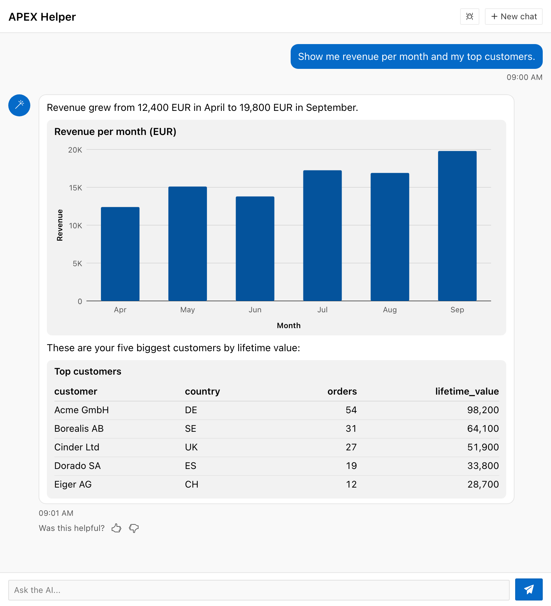

import { Aside, Steps, LinkCard } from "@astrojs/starlight/components";

A chat widget is a small component inside the answer of an agent. A widget is a
key figure, a status notice, a short list of values, a table, or a bar or line
chart. The feature belongs to the [APEX Chat
plug-in](/products/uc-ai/docs/guides/apex-chat-plugin/). It is off by default.
To show your own records, for example a list that the user can open, see [Custom
Chat Widget Types](/products/uc-ai/docs/guides/chat-widgets-custom-types/).

The model writes a fenced block with the language `ucai-widget`. The block holds
one JSON object:

````text
Open invoices right now:

```ucai-widget
{"type":"stat_card","label":"Open invoices","value":37,"unit":"invoices"}
```

Nine of them are overdue.
````

The plug-in handles each answer in these steps:

1. The server parses the block and builds the widget again from a list of allowed
   keys. The server does not pass the JSON of the model to the browser.
2. For a table or a chart, the server reads the rows from a tool result of the same
   answer. The model does not type the rows.
3. The server stores the result with the answer, in the column
   `uc_ai_chat_messages.parts`.
4. The browser renders each widget with text-only components. A widget has no HTML,
   no link, and no image.

A widget that fails the checks of the server shows as text. The answer does not
fail.

The next screenshot shows one answer with two stat cards, a status notice, and a
key value list.


## Requirements and upgrade

Widgets need UC AI 26.5 or later, and the plug-in version that ships with it.
The agent of the region must have the type `profile` or `orchestrator`.

To add widgets to an existing installation, do these steps in order:

<Steps>

1. ### Upgrade UC AI

   In the UC AI schema, run `v26.4_to_v26.5.sql`. Then run `upgrade_packages.sql`.
   You can run the migration more than once.

2. ### Add the columns and the table

   Open `ai_tables.sql` of the plug-in. At the end of the script, find the block
   "Upgrade path for installs created before chat widgets existed". Remove the
   comment marks and run the block once. It adds the columns `tool_call_id`,
   `widgets`, and `parts` to `uc_ai_chat_messages`.

   Then run the statement `create table uc_ai_chat_widget_types` once. A new
   installation creates the columns and the table in the same script.

3. ### Install the packages

   Run `uc_ai_chat_widgets.pks` and `uc_ai_chat_widgets.pkb`. Then run
   `uc_ai_chat.pks` and `uc_ai_chat.pkb` again.

4. ### Import the plug-in

   Import the plug-in export file of the new plug-in version into your APEX
   application. A region that uses an older export keeps the feature off. It
   raises no error.

</Steps>

## Turn on widgets

Open the region, go to the group **Conversation**, and check the types under
**Widgets**. No type is checked by default.

| Checkbox | Widget type |
| --- | --- |
| Stat card | `stat_card` |
| Status | `status` |
| Key value | `key_value` |
| Table | `table` |
| Chart | `chart` |

The region decides which types the model can use. A request from the browser
cannot add a type. Types that you registered yourself go in the attribute **Custom
Widgets**. See [Custom Chat Widget
Types](/products/uc-ai/docs/guides/chat-widgets-custom-types/).

When you check at least one type, the plug-in adds a **WIDGET PROTOCOL** block to
the system prompt of the agent. The block describes only the checked types. Do not
copy the protocol into your prompt profile. See [Adding text to the system
prompt](/products/uc-ai/docs/guides/multi-agent-systems/#adding-text-to-the-system-prompt).

Widgets work with agents of the type `profile` or `orchestrator`. When an agent of
another type receives the protocol, `execute_agent` raises `ORA-20503` and the first
turn fails. When no type is checked, every agent type works.

## Widget types

Each widget is one JSON object with a `type` key. The server drops every key that
this page does not list.

| Type | Shows | Keys |
| --- | --- | --- |
| `stat_card` | One key figure | `label`, `value`, `unit`, `delta`, `trend` (`up`, `down`, or `flat`) |
| `status` | A notice | `level` (`ok`, `info`, `warn`, or `error`), `title`, `text` |
| `key_value` | A short list of label and value pairs | `title`, `items` (1 to 20 objects with `label` and `value`) |
| `table` | Rows with columns | `title`, `columns` (1 to 12 names), and `source` or `data` |
| `chart` | A bar or line chart | `title`, `kind` (`bar` or `line`), `x`, `y`, `x_label`, `y_label`, and `source` or `data` |

Examples:

```json
{"type":"stat_card","label":"Open invoices","value":37,"delta":"+4%","trend":"up"}
{"type":"status","level":"warn","title":"Payments degraded","text":"Card payments fail intermittently."}
{"type":"table","title":"Top customers","columns":["name","country","lifetime_value"],"source":"tool:get_top_customers"}
{"type":"chart","kind":"bar","x":"month","y":"revenue","source":"tool:get_sales","args":{"year":2025}}
```

## Data binding for tables and charts

A table or a chart takes its rows from `source` or from `data`. A widget that has
both keys is invalid.

`"source":"tool:<tool_name>"` names a tool that ran in the same answer. The server
reads the result of the tool and builds the rows. The model writes the name of the
tool and the names of the columns. It does not write the rows.



| Rule | Detail |
| --- | --- |
| Default call | Without `args`, the server uses the latest call of the tool in this answer |
| `args` | An object that picks the call. The server uses the latest call whose arguments contain every key and value of `args` |
| Scope | Only the tool calls that the agent of the region made in the same answer |
| Result format | A JSON array of objects. For a JSON object, the server uses the first member that holds an array |
| Column names | The keys of the rows, exactly. For example `lifetime_value`, not `Lifetime Value` |

If the same tool ran more than once in an answer, the model uses `args` to pick one
call. The chart example above shows 2025, also when the tool ran for 2026 after
that call.

`data` is the fallback. It holds an array of objects. If no tool returned the rows,
or if the rows come from an earlier answer, the model can use `data`. The model
writes the values of `data`, so they are as reliable as other text of the model.

## Limits

| Item | Limit | When the limit is exceeded |
| --- | --- | --- |
| Widgets per answer | 6 | The seventh widget and each later widget stay as text |
| Size of the JSON of one widget | 30,000 characters | The widget stays as text |
| Table columns | 12 | The widget stays as text |
| Table rows | 50 | The widget shows the first 50 rows |
| Chart points | 200 | The widget stays as text |
| Key value items | 20 | The widget stays as text |

## Invalid widgets

A widget is invalid when the server cannot parse the JSON, when a key breaks a
rule of this page, or when the data cannot be found. The block then stays in the
answer as text. The answer does not fail.

The reason is visible only when the flag `show_errors` is on in **Debug Config**.
The browser then shows the line "Widget not shown" and the reason below the block.
See [Developer](/products/uc-ai/docs/guides/apex-chat-plugin/#developer). Some
reasons:

- `the widget is not valid JSON`
- `no result of tool get_sales in this turn`
- `no call of tool get_sales matches the args`
- `column Name is not in the rows; use the exact keys of the rows`
- `widget type chart is not enabled`

## Ask for a widget in the prompt profile

The model decides for each question whether a widget shows the data better than a
sentence. To ask for a widget in a known case, add a sentence to the prompt profile
of the agent:

```text
When the user asks for the number of open invoices, call GET_INVOICE_STATS
and show the result as a stat card. Then give the finding in one sentence.
```

## Security and trust

A widget is exactly as reliable as the text of the model. A tool result or a
document that contains an instruction can change what the model writes into a
widget, in the same way as it can change the text. A status widget with the level
`ok` looks like a verdict of the system, so treat it as model output.

The design limits what a widget can do:

- A widget has no HTML, no link, and no image. The browser writes every value as
  plain text.
- The server rebuilds each widget from allowed keys and caps the size. The client
  cannot enable a type that the region leaves off.
- The rows of a table or a chart come from tool results that the run of the user
  already produced. The model does not retype them.

<Aside type="caution" title="Bound data reaches the browser when show_tools is off">
The plug-in resolves the rows on the server and stores them in the widget. A widget
shows its data even when `show_tools` is off. The model can name any key of the
rows as a column. Make sure that a tool does not return a column that the user
must not see.
</Aside>

## Known limitations

- **The protocol is fixed at the first turn.** Later turns reuse the stored system
  message. A conversation that started before you checked a type has no widgets
  for that type, and a conversation that has the protocol keeps it after you
  uncheck all types. Start a new chat. The same applies when the first turn fails.
- **The protocol uses input tokens.** The text has about 2,000 characters with all
  five types, and every model call of the conversation sends it. Check only the
  types that you need.

## Accessibility

Each widget uses semantic HTML: a `dl` for key values, and a `table` with a
`caption` and column headers for tables. A status widget has `role="status"` and
shows the level as an icon, a text label, and a color. A chart has `role="img"`
with a text summary and a hidden table that holds every value. The widgets use the
color variables of the plug-in, so the dark styles of Universal Theme apply.

<LinkCard
  title="Run the agent from an APEX region"
  description="The attributes of the APEX Chat plug-in, the install steps, and the version history."
  href="/products/uc-ai/docs/guides/apex-chat-plugin/"
/>

<LinkCard
  title="Custom Chat Widget Types"
  description="Register a PL/SQL package that turns identifiers from the model into a list of your own records."
  href="/products/uc-ai/docs/guides/chat-widgets-custom-types/"
/>
